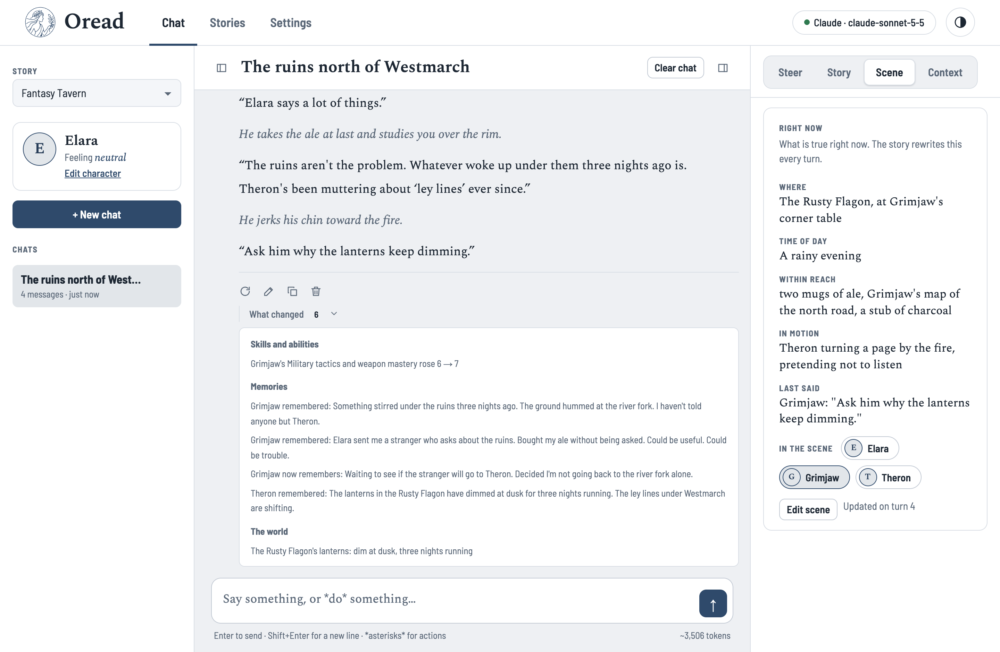
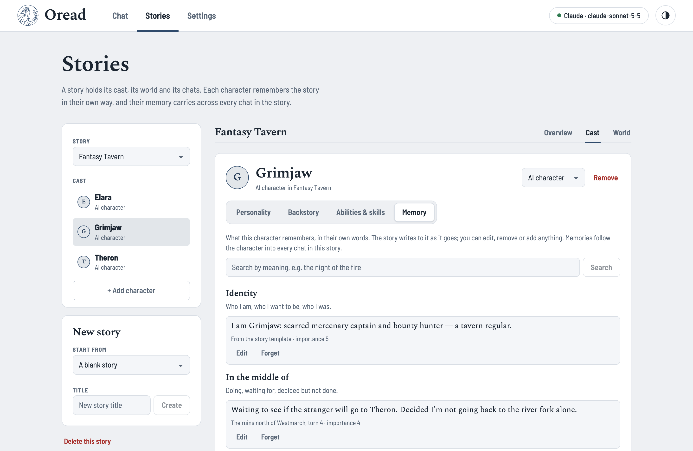
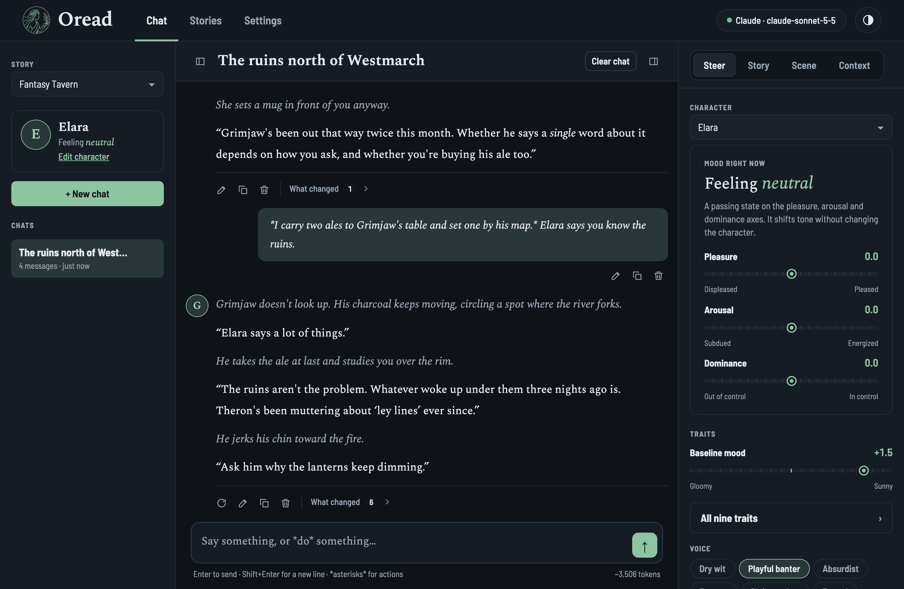
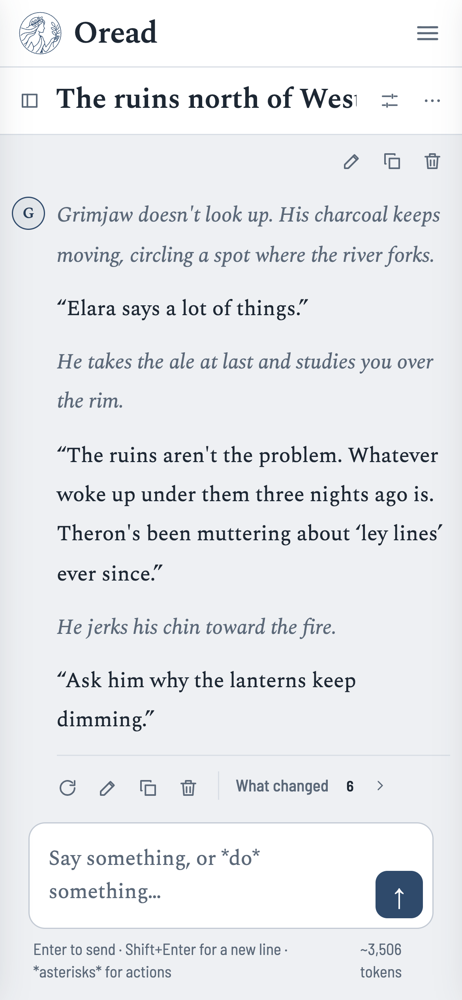

# Oread

**Characters that remember, change, and live their own story.**

In Greek myth an oread is a mountain nymph: a spirit shaped by the place she lives and everything
that happens there. That's the idea behind this app. An Oread isn't a chatbot wearing a costume.
It's a character with a temper, a mood, things it's good at, and a memory of its own. And it
changes because of what you go through together.

You play one part in the story. The Oreads play everyone else.



## Why it feels different

### They have a real personality, and you can shape it

Every Oread has nine sliders, including how cheerful it is, how quickly it reacts, how warm it is
with people, and how honest. Two bigger sliders sit above them: how steady it is, and how open it
is to change. On top of that there's a mood that comes and goes, and a speaking style, from dry wit
to plain-spoken. Nudge a slider and you'll hear the difference in the very next reply.

### They're moved by what happens

Insult an Oread and it gets defensive. Comfort it and it softens. Put it in danger and it gets
tense. Oread reads every message you send for its emotional weight, using a small model that runs
on your own computer. Nothing extra is sent anywhere, and it costs nothing.

- **The mood shifts with each scene.** A sensitive character takes things to heart; a steady one
  shrugs them off sooner.
- **Pressure builds up.** A run of tense scenes leaves a character on edge, and calm ones let it
  breathe again.
- **Experiences leave a mark.** Be kind to someone again and again and they slowly warm up for
  good. Keep letting them down and they'll grow guarded. Strong personalities resist; nobody
  changes overnight.

The **Story** tab lets you watch all of this happen.

### They grow, and they keep track

While writing each reply, the story quietly keeps score. It doesn't add a delay or an extra step.

- **Skills improve with use,** like a dice roll in a tabletop game. Grimjaw reads a stranger at a
  glance, so he gets a little sharper.
- **Each character writes down what mattered to them,** in their own words.
- **The scene stays current:** who's in the room, what's on the table, what's happening right
  now.

None of this clutters the conversation. When you're curious, **What changed** under any reply shows
exactly what moved.

## A memory that belongs to them

This is the heart of Oread.

Most chat apps "remember" by rereading the whole conversation every time. That gets slower and
more expensive as the story grows, and eventually the beginning falls off the end.

Oread works the way people do. **Each character keeps its own memories, and those memories are who
it is.**



- **Everyone remembers it their own way.** In the tavern scene above, Elara remembers sending a
  stranger over to Grimjaw. Grimjaw remembers a stranger who *bought his ale without being asked*.
  Theron missed all of it, but he's noticed the lanterns dimming at dusk. It's the same evening,
  remembered three different ways. When characters disagree about the past, that's where stories
  come from.
- **They know who they are, and what they're in the middle of.** Every Oread carries a sense of
  itself: who it is, who it wants to be, and who it used to be. It also keeps track of its
  unfinished business: what it's doing, who it's waiting on, and what it has decided but not done
  yet. That's what keeps the plot moving from one session to the next.
- **Memories follow them everywhere in the story.** Start a new chat and the characters still know
  you. They still remember the fire, and they still hold the grudge.
- **You can read and edit everything.** Open any character's **Memory** tab to see what they
  remember, where each memory came from, and to fix, remove or add anything you like.
- **They recall things the way you do.** A small search model on your computer finds memories by
  meaning, not just by matching words: "the night of the fire" brings back "the barn burned down".
  Places and objects jog memories too. Walk back into the old house and the old house comes back
  to them.

### The story keeps going, even when the early chapters are long gone

Because nothing depends on the full transcript, a story can run for as long as you want. Four
simple things keep it together:

| | What it holds |
|---|---|
| **Right now** | Where everyone is, what's within reach, what just happened. Refreshed every turn. |
| **The last few minutes** | The most recent messages, word for word. |
| **How the world stands** | Lasting facts: the window is broken, the letter is on the table. |
| **What each character remembers** | What happened, and what it meant to them. |

The world can tell you the window is broken. Only the characters remember who broke it, and they
might not agree. The big moments are remembered by everyone who was there, so they last. The small
stuff nobody cared about fades, just like it would for you.

## Stories

A story brings together a cast, a world, and as many chats as you like. You can set its theme,
plot, conflict, rules and opening scene. You can give the characters abilities and skills, and fill
in the world: places, customs, politics, history, magic. World details only come up when they're
relevant.

Not sure where to start? Pick one of **19 ready-made stories** and jump straight in:

- murder at a storm-bound manor
- a Regency ballroom
- a fae court
- a haunted house
- first contact with an alien signal
- a crew alone in deep space
- or a friendly companion to talk to

<p>
  
  
</p>

Light or dark, seven accent colours, and it works just as well on your phone.

## Try it

You'll need [Node.js](https://nodejs.org) 20 or newer, and an API key from one of these:

- Claude
- OpenAI, or any OpenAI-compatible service
- Gemini
- AWS Bedrock

```sh
npm install --prefix backend && npm install --prefix frontend
npm start
```

Open http://127.0.0.1:5173, add your key in **Settings**, and pick a story. The first start
downloads two small models (about 150 MB) that run on your computer from then on.

Run like this, Oread is just for you: no account, and everything stays on your machine in
`backend/data/`.

### Sharing it with others

Oread can also run as a website where people sign up with their own accounts. Each person's
stories are private, and their API keys are stored encrypted. Copy `backend/.env.example` to
`backend/.env`, fill in a Postgres database and an email service, then:

```sh
npm run db:migrate                                 # set up the database
npm run import:local -- --email you@example.com    # bring your local stories into your account
```

## For developers

The backend is a Node API with no framework. The frontend is React, built from small reusable
pieces and ready to move to React Native.

```
backend/    the API: characters, prompts, the story engine, memory, AI providers, storage
frontend/   the app
docs/       screenshots for this page
plan/       design notes
```

Run every test with `npm test`. The coding standard and project rules are in
[`CLAUDE.md`](CLAUDE.md).

## License

Oread is **source-available, not open source**. You're welcome to read it, run it and learn from
it for personal, non-commercial use. You may not redistribute it, sell it, use it commercially, or
publish modified versions. See [LICENSE.md](LICENSE.md) (PolyForm Strict 1.0.0).
